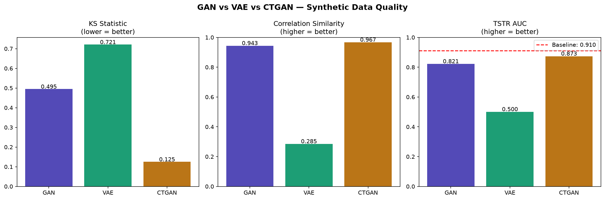
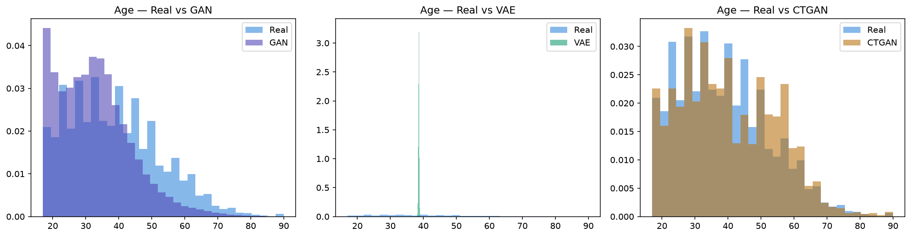

# Synthetic Data Generation: GAN vs VAE vs CTGAN

Comparative study of three generative models on the Adult Income dataset, evaluating synthetic data quality using statistical fidelity metrics and a downstream ML task.

## Results

| Model | KS Statistic | Corr Similarity | TSTR AUC |
|---|---|---|---|
| GAN (scratch) | 0.495 | 0.943 | 0.821 |
| VAE (scratch) | 0.722 | 0.285 | 0.500 |
| CTGAN (SDV) | 0.125 | 0.967 | 0.873 |

Baseline AUC (train on real): 0.910

## What it does
- Builds GAN and VAE from scratch in PyTorch
- Uses CTGAN via SDV library as production baseline
- Evaluates all three using KS statistic, correlation similarity, and TSTR AUC
- Explains why CTGAN outperforms vanilla GAN and VAE on mixed tabular data

## Tech stack
PyTorch, SDV, Scikit-learn, Pandas, Scipy, Matplotlib, Seaborn

## Setup

    git clone https://github.com/adityabandal21/synthetic-data-gen.git
    cd synthetic-data-gen
    python3.11 -m venv venv
    source venv/bin/activate
    pip install -r requirements.txt

## Run

Run the notebooks in order from the `notebooks/` folder:

1. `01_eda.ipynb`: explore the Adult Income dataset
2. `02_gan.ipynb`: build and train the GAN
3. `03_vae.ipynb`: build and train the VAE
4. `04_ctgan.ipynb`: train CTGAN with SDV
5. `05_evaluation.ipynb`: compare all three models

Generated synthetic datasets and charts are saved to `data/`.

## Key findings
- CTGAN achieves 0.873 TSTR AUC vs baseline 0.910, a gap of only 0.037
- VAE struggles with mixed data types, with a TSTR AUC of 0.5 (random chance)
- GAN preserves correlations (0.943) but distribution similarity is weaker
- CTGAN uses conditional generation and mode-specific normalization, which makes it purpose-built for tabular data
